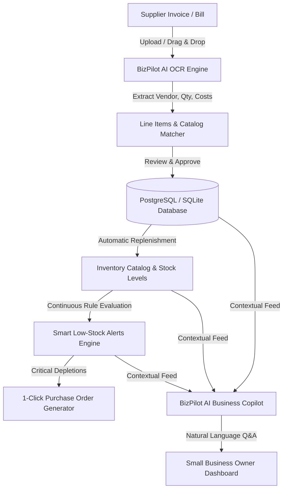

# BizPilot AI 🚀
### Automated Invoices, Inventory Management & AI Business Intelligence

> **BizPilot AI** is an intelligent web and API platform that empowers small businesses to automate supplier invoice processing, maintain real-time inventory counts, anticipate stockouts with deterministic rules, and query business intelligence using conversational AI.

---

## 🌟 Key Architecture & Capabilities



---

## 🏗️ What Was Built (Following the Exact Build Order)

### 1. Dashboard UI (`frontend/index.html` + `frontend/css/`)
- **Luxury Modern Dark Aesthetics**: Glassmorphic dark theme with cyber emerald, violet, and amber accents.
- **Real-Time KPI Cards**: Total Inventory Asset Valuation, Projected Gross Margins, Catalog Health Score, and Invoice Spend.
- **Dynamic Category Volume Charts**: Visual stock meters tracking physical units across categories.
- **Urgent Restock Radar**: Instant alerts with one-click reorder drafts.
- **Recent Invoices Feed**: Audit log of uploaded bills and approval states.

### 2. Backend & Database (`backend/app/main.py` + `backend/app/database.py`)
- **Python + FastAPI**: High-performance asynchronous API endpoints with CORS, input validation, and file streaming.
- **Relational PostgreSQL Schema (with SQLite zero-config fallback)**:
  - `User`: Business accounts and currency settings.
  - `Product`: SKUs, stock counts, min alert levels, cost prices, selling prices, and suppliers.
  - `Invoice` & `InvoiceItem`: Line item details, tax, vendor metadata, OCR raw text, and approval audit timestamps.
  - `Alert`: Severity rating (`critical`, `warning`), messages, and resolution states.
  - `StockHistory`: Change ledger tracking exact increments/decrements with reason codes.

### 3. Invoice Upload & AI OCR Extraction (`backend/app/ocr_engine.py` + `frontend/js/invoices.js`)
- **Optical Scanner HUD**: Drag-and-drop zone with animated laser scanning beam.
- **Smart Line Item Parser**: Automatically parses vendor name, invoice numbers, quantities, unit prices, subtotal, and tax.
- **Catalog Auto-Matcher**: Matches invoice descriptions against existing inventory SKUs or flags new items for automatic cataloging.
- **Instant Sample Bills**: 1-click test buttons for Tech Hardware, Coffee Roastery, and Packaging bills.
- **Approve & Update Inventory**: 1-click approval button that adds stock to warehouse counts and writes audit records.

### 4. Inventory Management (`frontend/js/inventory.js`)
- Search by SKU or product name with live filtering.
- Filter by category (`Electronics`, `Packaging`, `Pantry`, `Office`, etc.) and stock condition (`Healthy`, `Low Stock`, `Out of Stock`).
- **Inline (+ / -) Quick Stock Adjuster**: Modify physical inventory in real-time.
- **Margin & Profit Calculator**: Visual profit margin computation per product.
- **Add Product Modal**: Complete product cataloging form with validation.

### 5. Automatic Low-Stock Alerts (`backend/app/alerts_engine.py` + `frontend/js/alerts.js`)
- **Deterministic Python Rules**: Runs fast business logic without costly external API calls:
  - `critical`: Stock = 0 or below 35% of minimum threshold.
  - `warning`: Stock below safety threshold.
  - `resolved`: Automatically clears warnings when stock is replenished.
- **1-Click Purchase Order Generator**: Automatically calculates recommended reorder quantities and drafts POs for suppliers.

### 6. Conversational AI Assistant (`backend/app/ai_assistant.py` + `frontend/js/ai-chat.js`)
- ChatGPT/Claude style conversational copilot grounded in real database state.
- **Clickable Prompt Chips**:
  - *"Which products are running low?"*
  - *"What is our total inventory holding value?"*
  - *"Show me pending invoices that need review"*
  - *"Draft a restock order for depleted items"*
- Real-time typing animation and Markdown rendering.
- Dual-mode intelligence: works 100% autonomously offline, with optional OpenAI/Gemini integration via `.env`.

---

## 🚀 Quickstart Guide

### Option A: Launch the Web App Instantly (Zero Setup)
Simply open the web application directly in your browser:
```
C:\Users\ritvik\.gemini\antigravity-ide\scratch\bizpilot-ai\frontend\index.html
```
- Works out-of-the-box with preloaded realistic small business data.
- State is persisted automatically to your browser's `localStorage`.
- All features (OCR Scanner, AI Assistant, Inventory Adjustments, Smart Alerts) are fully interactive!

---

### Option B: Run the Python FastAPI Backend & PostgreSQL

1. **Navigate to the backend directory**:
   ```bash
   cd C:\Users\ritvik\.gemini\antigravity-ide\scratch\bizpilot-ai\backend
   ```

2. **Install Python dependencies**:
   ```bash
   pip install -r requirements.txt
   ```

3. **Start the FastAPI Dev Server**:
   ```bash
   uvicorn app.main:app --reload --port 8000
   ```
   - Interactive API Swagger Docs: `http://localhost:8000/docs`
   - Redoc Specification: `http://localhost:8000/redoc`

4. **(Optional) Run with Docker Compose (PostgreSQL + FastAPI)**:
   ```bash
   docker-compose up -d
   ```

---

## 📂 Project Directory Structure

```
bizpilot-ai/
├── backend/
│   ├── app/
│   │   ├── __init__.py
│   │   ├── main.py              # FastAPI application with REST endpoints
│   │   ├── database.py          # SQLAlchemy PostgreSQL + SQLite dual engine
│   │   ├── models.py            # User, Product, Invoice, Alert, StockHistory
│   │   ├── schemas.py           # Pydantic validation schemas
│   │   ├── ocr_engine.py        # OCR text & invoice structure extraction
│   │   ├── alerts_engine.py     # Python rule-based low-stock alerts
│   │   ├── ai_assistant.py      # Business intelligence conversational Q&A
│   │   └── seed_data.py         # DB population script
│   ├── requirements.txt         # Pinned backend dependencies
│   ├── docker-compose.yml       # 1-Command Postgres + Backend deployment
│   └── .env.example             # Environment configuration template
├── frontend/
│   ├── index.html               # Main dashboard UI
│   ├── css/
│   │   ├── style.css            # Dark luxury design system & layout
│   │   └── components.css       # Cards, tables, OCR scanner, AI chat, modals
│   ├── js/
│   │   ├── data.js              # Initial mock products & sample bills
│   │   ├── app.js               # State manager & API sync
│   │   ├── dashboard.js         # Charts, KPI metrics & Restock radar
│   │   ├── invoices.js          # OCR scanner & inventory approval workflow
│   │   ├── inventory.js         # Catalog management & inline adjusters
│   │   ├── alerts.js            # Smart alerts & PO generator
│   │   └── ai-chat.js           # Conversational AI copilot
│   └── sample_invoices/         # Ready-to-test invoice documents
│       ├── invoice_sample_tech.json
│       └── invoice_sample_grocer.json
└── README.md                    # Project manual & documentation
```
